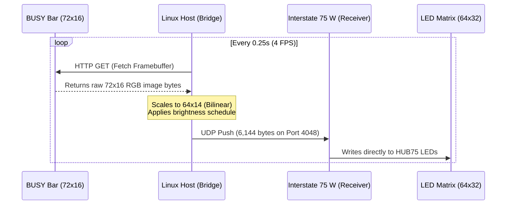

# Busy ReBar: Wireless BUSY Bar Repeater

**Busy ReBar** (BUSY Bar REpeater) is a wireless, real-time LED matrix repeater for the Flipper Devices BUSY Bar. 

The goal of this project is to accommodate situations where you cannot easily place the main color screen of the BUSY Bar facing visitors or colleagues. This often happens if turning the bar outward makes it inconvenient for you to control the buttons and read the secondary screen, if your monitors are oriented perpendicular to the direction you want the status shown, or if you need people to see your status from entirely outside the room.

Just like physical rebar reinforces and extends the structural strength of a building, BusyRebar reinforces and extends the visual reach of your BUSY Bar across your home or office.

## How It Works (Architecture)

BusyRebar offloads the heavy lifting (fetching HTTP images, resizing, and brightness scheduling) to a local Linux host, which then streams raw pixel data to a dumb Wi-Fi receiver attached to the LED matrix.

## 📺 Hardware & Screen Scaling

The BUSY Bar's native screen resolution is **72x16 pixels**. However, standard off-the-shelf HUB75 LED matrices come in powers of two, with **64x32 pixels** (like the P4 64x32 panel) being the most common and affordable.

Because 72 pixels are too wide to fit onto a 64-pixel display, `repeater.py` offers two ways to handle the conversion:

1. **Full-Width Bilinear Scaling (Default):** Smoothly resizes the entire 72x16 image down to 64x14. It uses bilinear interpolation to ensure the thin vertical strokes of countdown numbers don't get distorted or dropped. Works OK-ish.
2. **Inward Cropping:** Trims the left/right edges off the original image to make it fit, keeping the center pixels exactly 1-to-1.

## 🚀 Quick Start

### 1. The Receiver (LED Panel)

1. Flash your Pimoroni Interstate 75 W (RP2350) with the latest official MicroPython firmware.
2. Update the Wi-Fi credentials in `main.py`.
3. Save `main.py` to the Interstate 75 W using Thonny.
4. Plug the board into a reliable **5V/3A** power supply (a standard 1A/2A phone charger may not be enough, leading to controller restart and Wi-Fi connection dropping).

### 2. The Bridge (Linux Host)

1. Install requirements: `pip install Pillow requests busylib`
2. Update `repeater.py` with your BUSY Bar's IP and API PIN.
3. Run the script: `python3 repeater.py`

## ⚙️ Configuration Reference

### MicroPython Config (`main.py`)

Found at the top of `main.py`:

* `WIFI_SSID` / `WIFI_PASSWORD`: Your 2.4GHz Wi-Fi network credentials.
* `UDP_PORT`: Port to listen on (Default `4048`).
* `wlan.ifconfig(...)`: **Crucial for stability.** Hardcode your desired Static IP here to bypass router DHCP assignment delays. Alternatrively, make sure to setup Static DHCP on your router.

### Linux Bridge Config (`repeater.py`)

Found at the top of `repeater.py`:

* **Network Setup:**
  * `BUSYBAR_IP` & `BUSYBAR_TOKEN`: The local IP and HTTP API PIN of your source BUSY Bar.
  * `PANEL_IP` & `PANEL_PORT`: The Static IP you assigned to your Interstate 75 W.
* **Scaling & Cropping:**
  * `ENABLE_CROP`: Set to `False` to smoothly scale the full screen. Set to `True` to crop the edges.
  * `CROP_LEFT` / `CROP_RIGHT` / `CROP_TOP` / `CROP_BOTTOM`: If `ENABLE_CROP` is `True`, these define how many pixels to slice inwards from each edge (e.g., `4` on left and right trims a 72px wide image down to 64px).
  * `OFFSET_X` / `OFFSET_Y`: Fine-tune the horizontal and vertical placement of the final image on the 64x32 black canvas.
